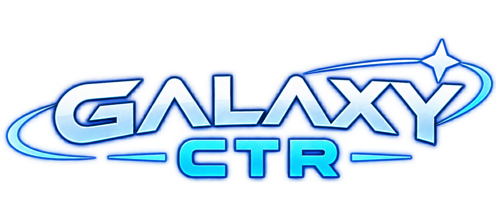

  

<i>A native port of Super Mario Galaxy for New Nintendo 3DS.</i>

  

---

GalaxyCTR runs *Super Mario Galaxy* (USA) on the New 3DS family. It is built on the
[Petari](https://github.com/SMGCommunity/Petari) decompilation, so the game's own code runs on
the 3DS. It is not an emulator.

> [!NOTE]
> **No game data is included.** You need your own copy of the game. The builder makes
> everything from it, on your computer.

> [!IMPORTANT]
> This is **not** a project of SMGCommunity, and it is not endorsed by them. The port's code is
> written with AI assistance ([details](docs/DETAILS.md#2-ai-use)).

The game is a **public beta**. It targets 30 FPS, and the busiest areas still run below full speed.

## What You Need

| | |
|---|---|
| **Console** | New 3DS, New 3DS XL or New 2DS XL with [Luma3DS](https://github.com/LumaTeam/Luma3DS) and a CIA installer such as FBI. The original 3DS and 2DS are not supported ([why](docs/DETAILS.md#11-new-3ds-only)). |
| **Game** | your own disc image of *Super Mario Galaxy*, USA release (`RMGE01`): ISO, WBFS, RVZ or another common format |
| **Computer** | Windows, Linux or macOS, with about 9 GB free |
| **SD card** | about 2 GB free |
| **Sound** | the file `sdmc:/3ds/dspfirm.cdc`. Run the homebrew app DSP1 once to create it. |

## How to Install

1. Download the builder for your system from [Releases](../../releases/latest).
2. Put it in a folder of its own and run it.
   - **Windows:** if SmartScreen stops it, choose *More info*, then *Run anyway*.
   - **macOS:** right-click it and choose *Open*.
   - **Linux:** run `chmod +x GalaxyCTR-Builder-linux-x86_64` first.
3. Choose your disc image. The conversion takes a while.
4. Copy the files to your 3DS: over Wi-Fi with an FTP app on the 3DS, or to the SD card in your computer.
   You can also copy them later. The steps are then saved in `install_guide.txt`.
5. Install `cias/GalaxyCTR.cia` with FBI.

Your saves are kept every time you run the builder.

## How to Update

Run the builder again, then install the new CIA. Before it starts, the builder downloads the
newest release by itself. Keep the `GalaxyCTR-Builder-files` folder next to the builder.
If you chose to keep the game files, the update does not need the disc image and is much faster
([details](docs/BUILDER.md#your-settings)).

## Help and Bug Reports

Ask in the [Discord server](https://discord.gg/Fftp79uaJ7). To report a bug, read
[CONTRIBUTING.md](docs/CONTRIBUTING.md) first: it says which files to send and where to find them.

## Documentation

Everything else is in [docs/](docs/README.md): what the builder does step by step, how to build
the port from source, and the design of the port.

## Credits and License

The port stands on the work of [SMGCommunity / Petari](https://github.com/SMGCommunity/Petari),
devkitPro and many others, listed in [docs/CREDITS.md](docs/CREDITS.md). The port's own code is
under the [MIT License](LICENSE). Petari's code keeps its CC0 licence
([LICENSE-Petari](LICENSE-Petari)).

Super Mario Galaxy is a trademark of Nintendo. This project is not affiliated with Nintendo.
